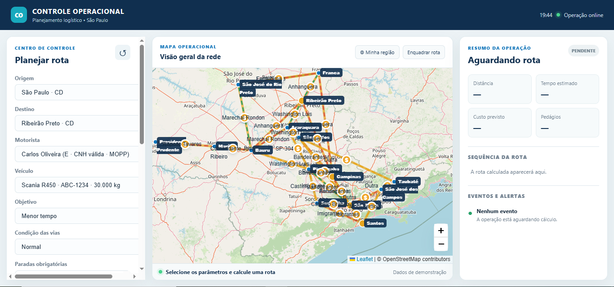
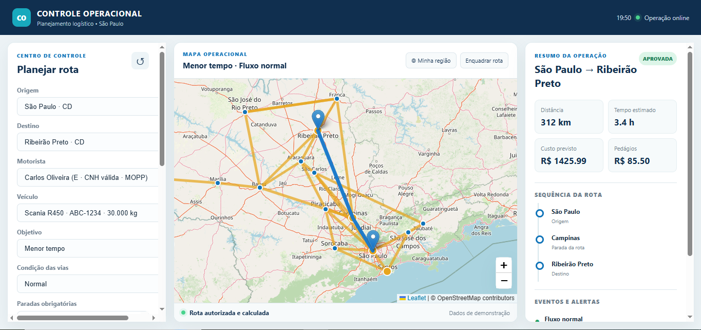
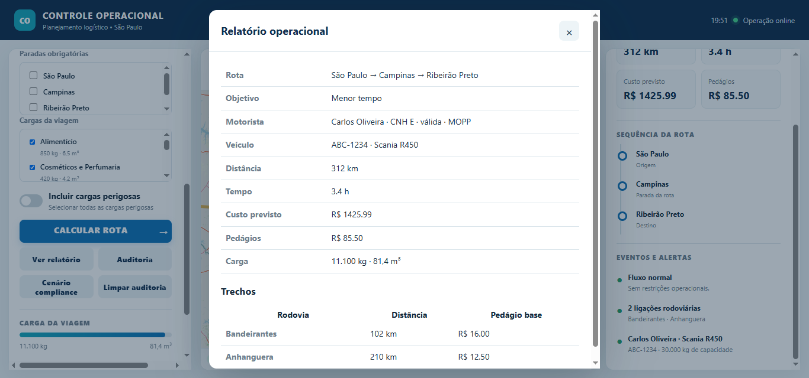
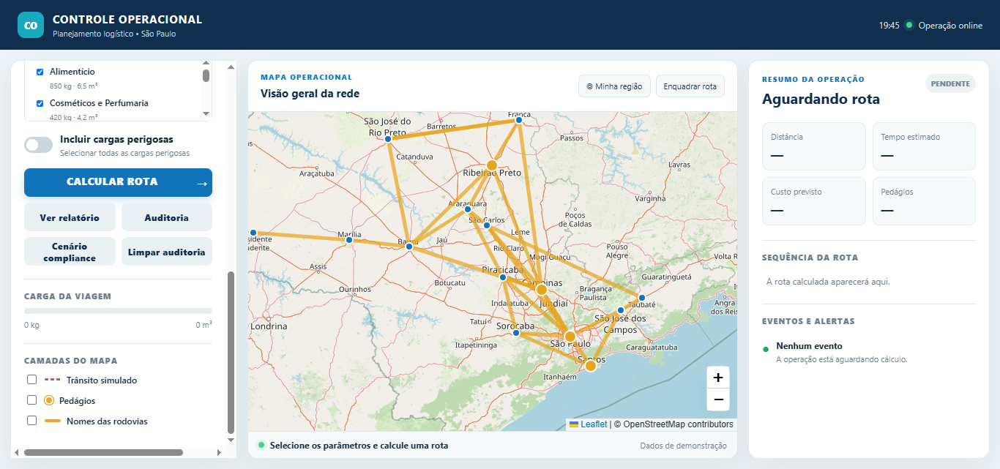

# Controle Operacional Web

## Descrição

O **Controle Operacional Web** é uma aplicação web acadêmica desenvolvida para simular o planejamento de operações logísticas.

O sistema permite selecionar origem, destino, motorista, veículo, cargas e condições das vias para calcular uma rota de transporte. Antes de autorizar a viagem, a aplicação também realiza validações de segurança e conformidade.

O projeto utiliza o algoritmo de Dijkstra para encontrar a melhor rota de acordo com o objetivo selecionado:

- Menor tempo
- Menor custo

> Este projeto foi desenvolvido para fins acadêmicos. Os dados utilizados são de demonstração e o trânsito apresentado é simulado.

---

## Funcionalidades

- Mapa interativo
- Seleção de origem e destino
- Seleção de motoristas e veículos
- Cálculo de rotas
- Escolha entre menor tempo e menor custo
- Seleção de encomendas
- Cadastro de paradas obrigatórias
- Cálculo do peso e volume da carga
- Validação da CNH do motorista
- Validação da categoria da CNH
- Validação do RNTRC do veículo
- Validação da licença MOPP
- Verificação de sobrecarga
- Verificação de cubagem excedida
- Simulação de chuva, tempestade, acidente e interdição
- Cálculo de pedágios
- Relatório operacional
- Sistema de auditoria
- Cenário de bloqueio por irregularidade
- Layout responsivo para computador e tablet

---

## Tecnologias utilizadas

- **HTML5:** Estrutura da aplicação, formulários, botões, listas, mapa e janelas de diálogo.
- **CSS3:** Estilização da interface, cores, espaçamentos, painéis, botões e layout responsivo.
- **JavaScript (ES6+):** Lógica da aplicação, validação de motoristas e veículos, cálculo das rotas, manipulação do DOM, relatórios e auditoria.
- **Leaflet:** Biblioteca JavaScript utilizada para criar o mapa interativo, marcadores, linhas, camadas, pedágios e rota calculada.
- **OpenStreetMap:** Fonte dos mapas utilizados como base para a visualização geográfica.
- **Algoritmo de Dijkstra:** Utilizado para encontrar a melhor rota entre as cidades, considerando menor tempo ou menor custo.
- **XAMPP ou Live Server:** Utilizado para executar o projeto localmente durante os testes.
- **GitHub:** Utilizado para armazenar e disponibilizar o código-fonte do projeto.

---

## Estrutura do projeto

```text
ControleOperacionalWeb/
├── index.html
├── styles.css
├── data.js
├── app.js
├── config.example.js
├── README.md
├── MANUAL.md
└── imagens/  
```

---

## Imagens da aplicação

### Tela principal



### Teste com rota e carga



### Cenário de bloqueio



### Mapa sem camadas



### Relatório operacional


---

## Como Executar Localmente

### 1. Clone o repositório ou baixe os arquivos

```bash
git clone https://github.com/CarolineGrizante/Controle-Operacional-Teoria-dos-Grafos-.git
```

### 2. Acesse a pasta do projeto

```bash
cd Controle-Operacional-Teoria-dos-Grafos-
```

### 3. Execute a aplicação

A aplicação pode ser executada utilizando:

- **XAMPP**
- **Live Server**, através do Visual Studio Code

Caso utilize o **Live Server**, abra o arquivo `index.html` e selecione a opção **Open with Live Server**.

---

## Observações

O sistema foi desenvolvido para fins acadêmicos e de demonstração.

As informações de motoristas, veículos, cargas, condições das vias, pedágios e trânsito são **dados simulados** e não representam informações reais de operações logísticas.

O mapa utiliza dados do **OpenStreetMap** e a biblioteca **Leaflet** para a visualização e interação com as rotas.
